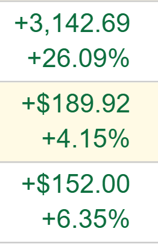

last Friday, the market crashed! today, i wake up to green lines going up! i think i'm going to go shopping with my girlfriend this week. you should of bought the dip. don't you see? if you are young, you have 30+ years to accumulate money, wealth, dollars. put it all in the stocks, because they reflect the value and economic output of our country. work hard, create value for society, be fiscally responsible, and you will be rewarded with the american dream--a house with a porch and second floor windows overlooking a river, a wife, kids, a dog, sipping drinks at the beach in different countries every other month...

no, that is continuously being taken away from you. [you will not have children](https://www.ssa.gov/policy/docs/ssb/v66n4/v66n4p37.html), and you will be funding the previous generations because of it. it isn't work or your actual production that is rewarded. it is ownership and capital which compounds on itself, and most people are not invited to the party, nor do they have the means or information to compete. this isn't sour grapes or growing into a commie mindset. i've benefitted from this bs.

they will tell you to be smart, work hard, stay up to date, study how the market works and you can join them. there are people whose main goal every single day is to hoard capital, make bets, and rent seek. these people do not output any economic value to the rest of the world. meanwhile, you are producing goods and services, providing value to the rest of society, and doing your part in growing the pie. if the pie grows for everyone, it doesn't matter if you only have a small piece of a huge pie! do you really think your you can peek from outside every now and then, strike gold once in a while, but at the end of the day, you were convinced that [wealth trickles down](https://www.law.georgetown.edu/denny-center/blog/reaganomics/). "no, i will use my savvy tech skills, research, and keep up to date with the news, so i can also benefit from the wealth our country is producing!"...they have satellites that [calculate oil storage tanks](https://medium.com/planet-stories/a-beginners-guide-to-calculating-oil-storage-tank-occupancy-with-help-of-satellite-imagery-e8f387200178), machines connected to grids with hundreds of thousands of cores/GPU clusters, carefully tuned FPGAs to confirm market decisions in nanoseconds. they operate at the petaflop level, while you sit at at teraflops. you cannot compete.

they, the mystical entity all dystopian novels are imbued with, the deep state, the lizard people, the white old guy, the banks, HFT firms, whoever or whatever it is. it doesn't matter. the problem will always be the same. your 401k, retirement savings, your dollars are backed by NOTHING. they can take that away from you whenever they feel like it. they will borrow and inflate away your purchasing power while [increasing their assets](https://mises.org/mises-wire/cantillon-effects-why-inflation-helps-some-and-hurts-others#:~:text=Cantillon%20was%20a%20gallicized%20Irish%20merchant%2C%20banker%2C,the%20business%20cycle**%20*%20**The%20price%2Dspecie%2Dflow%20mechanism**). [try](https://www.us-debt-clock.com/) calculating when you can retire. there's no wonder no one in this generation is thinking long-term on anything anymore. one day, we're all just going to be plugged into gta 6 and experience freedom there. at least neuralink is preparing for [this](https://www.tomshardware.com/peripherals/wearable-tech/neuralink-trial-participant-ditches-mouth-stick-to-play-gta-6-with-his-mind-brain-computer-interface-maps-imagined-ring-finger-taps-and-hand-slides-to-a-playstation-5-controller) future.

people seem to constantly dismiss the fact that dollars have no meaning. at the most fundamental level, it's all about production of goods and services. ask yourself, how much value does your job or these megacorporations output? are you consolidating information, power and compute, or are you helping decentralize? nothing is free. move to another country, stay, but we all live in a society. we all rely on each other. 

i need to stop writing and go back to doing work, because i just got an important Teams message. it's going to be ok as long as green line keeps going up.